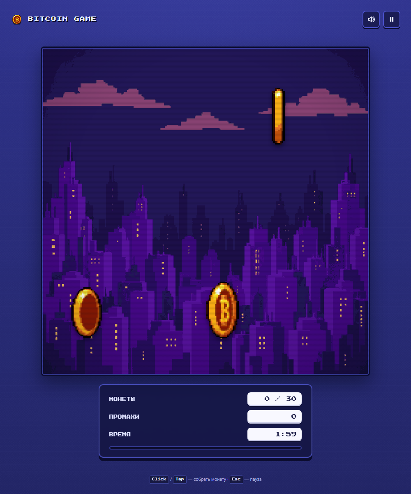
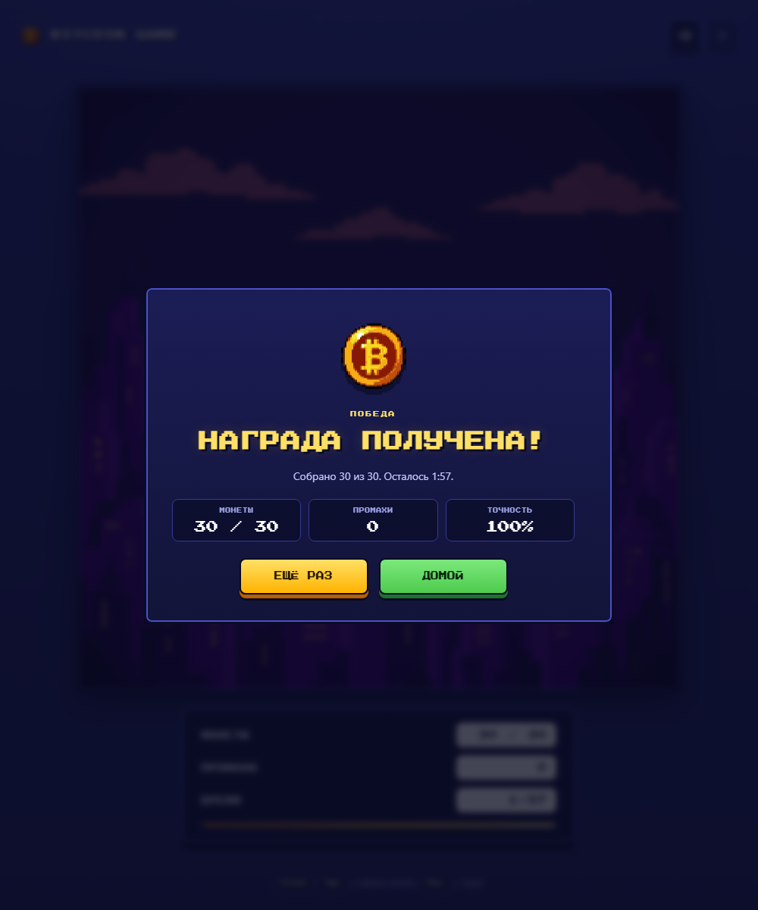
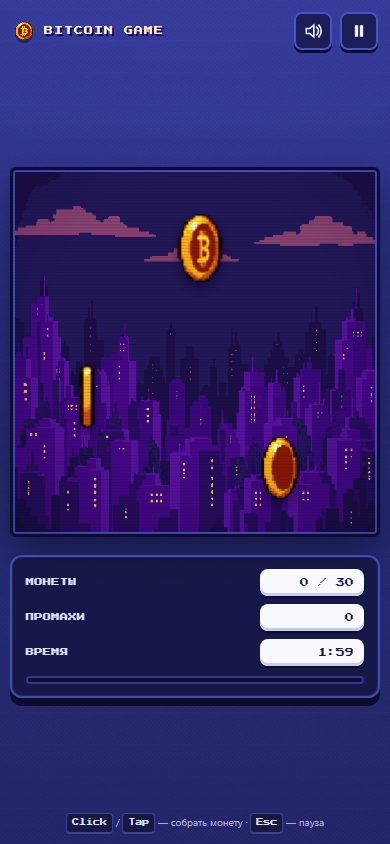
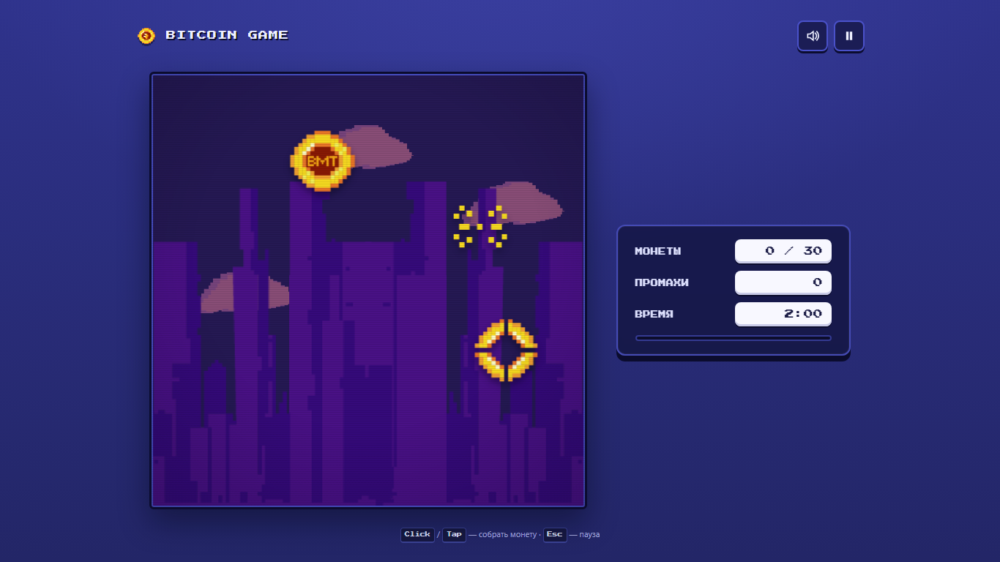
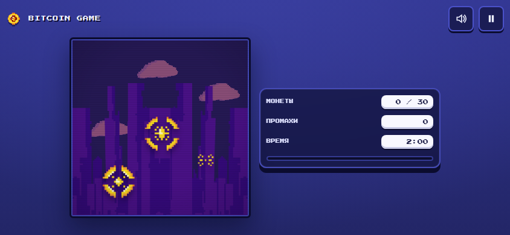

<div align="center">

# BITCOIN GAME

**Собирай вращающиеся биткоины, не промахивайся и успей до конца таймера.**

Аркадный ремейк игры 1998 года — теперь на TypeScript, с адаптивным интерфейсом,
звуком и полноценной клавиатурной навигацией.


[](https://github.com/AlexMerf/BitcoinGame/actions/workflows/ci.yml)

</div>

## 🕹 Об игре

Три вращающиеся биткоин-монеты, две минуты и цель — собрать **30 монет**. Клик или
тап по монете приносит очко; не успевшая монета улетает и считается промахом,
пустой клик по полю — тоже. За промахами и таймером следит HUD, а в конце ждёт
экран с результатом и точностью.

Внешне это та самая аркада с ужасным (в хорошем смысле) ретро-шрифтом и
пиксельными спрайтами, но внутри — аккуратное современное приложение: пауза,
звук, сохранение рекорда и нормальное поведение на телефоне.

## 📸 Скриншоты





<details>
<summary>Стартовый экран, мобильная и ландшафтная версии</summary>








</details>

## ✨ Что внутри

- 🪙 **17 кадров анимации** — монета вращается так же, как в оригинале 1998 года.
- ⏱ **Две минуты на 30 монет** — таймер, промахи и точность в конце раунда.
- 📱 **Любой экран** — портретная раскладка, боковая панель на ноутбуке, ландшафт телефона.
- 🎛 **Пауза** по кнопке, `Esc` или при переключении вкладки.
- 🔊 **Звук без аудиофайлов** — короткие сигналы на Web Audio API, отключаются и запоминаются.
- 🏆 **Рекорд** сохраняется в `localStorage`.
- ♿ **Доступность** — `Tab`/`Enter`, `aria-live`, `prefers-reduced-motion`, видимый фокус.
- 🔌 **Без бэкенда и внешних запросов** — шрифт и все картинки лежат в бандле.

## ▶️ Запустить

```bash
npm ci
npm run dev
```

Откройте `http://localhost:5173`. Нужен Node.js 22.12+.

## 🧱 Технологии

TypeScript · Vite · Vitest · Web Audio API · Fontsource. Без фреймворков и
виртуального DOM: логика игры — чистый `GameEngine`, покрытый unit-тестами,
рендер — один класс на DOM. Production-сборка — около 18 KB JS и 14 KB CSS
до gzip.

## 📜 Наследие 1998 года

Проект вырос из скрипта «Kill Leonardo Di Caprio Now!» (1998, Andryxa,
ishodniki.ru): спрайты Леонардо заменены на биткоин-монеты, добавлены макеты и
новый интерфейс. Оригинальная страница сохранена и работает — см.
[`legacy/README.md`](legacy/README.md). Исходные макеты дизайнера лежат в
[`design/`](design/README.md).

## 🗂 В репозитории

- [`src/`](src) — игра: логика, интерфейс, ассеты;
- [`design/`](design/README.md) — исходные макеты дизайнера;
- [`docs/screenshots/`](docs/screenshots) — скриншоты для этого README;
- [`legacy/`](legacy/README.md) — оригинальная страница 1998 года.

---

Спрайты и код оригинала — 1998 года; права на исходные ассеты перед публикацией
стоит проверить. Шрифт Press Start 2P распространяется по SIL Open Font License.
